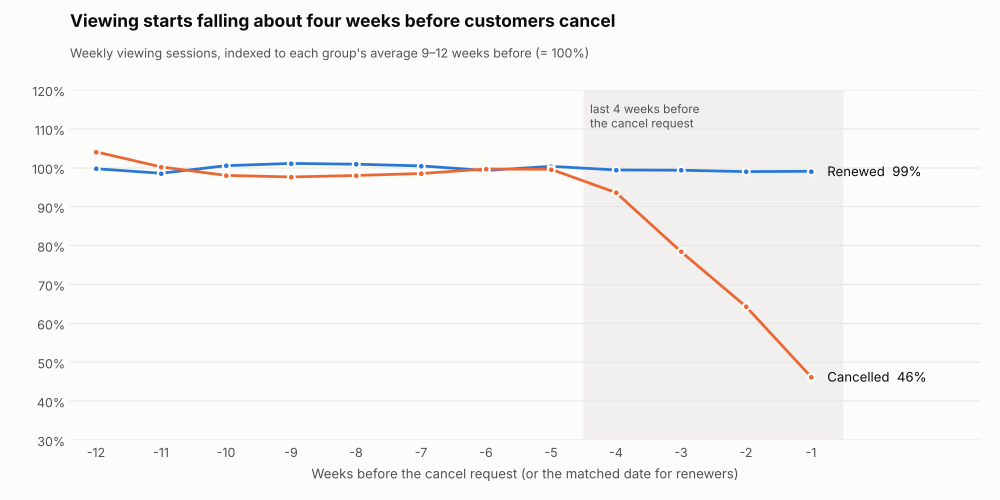
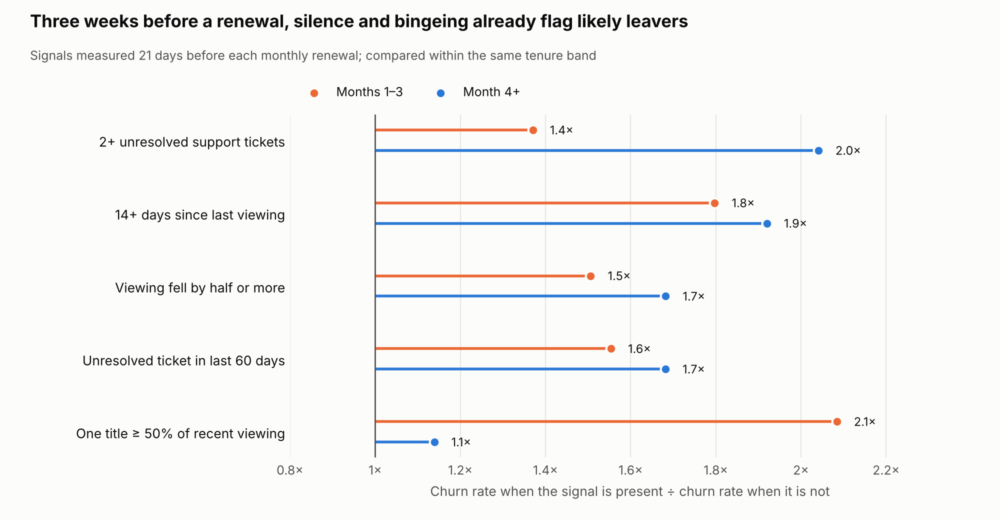
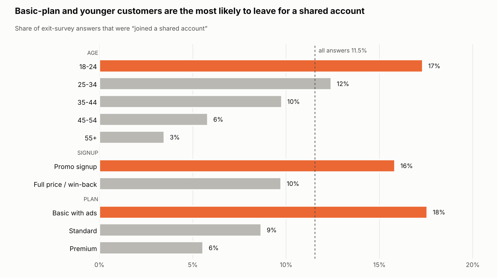

# Behavioural Drivers

**Question:** What do customers do before they cancel, and how early can we see it?

Run: `python src/run_sql.py` then `python src/behaviour.py`.

## Setup
- `sql/06_renewal_snapshots.sql` builds one row per monthly subscription per renewal (319,091 renewals excluding payment failures; 7.5% end in a voluntary cancellation).
- Every behaviour feature is measured **21 days before the renewal**. Customers ask to cancel at most 20 days before the period ends, so nothing after the snapshot leaks into the features. The 21 days are also the time a retention team would have to act.
- Signals are compared **within the same tenure band** (months 1–3 vs month 4+), because new customers both churn more and have less viewing history.

## 1. Viewing drops for about four weeks before a cancellation

Customers who cancelled watched as much as renewers until five weeks before the cancel request. Viewing then fell to 94%, 78%, 64% and finally **46%** of its earlier level in the last week. Renewers stayed flat at 99%.

The decline is clear in hindsight, but only its early part is visible 21 days before a renewal, which is why the signals below are weaker than this chart suggests.

## 2. Warning signals 21 days before a renewal

| Signal | Tenure | Renewals flagged | Churn if flagged | Churn otherwise | Lift | Churners caught |
|---|---|---|---|---|---|---|
| 14+ days since last viewing | months 1–3 | 9.5% | 22.1% | 12.3% | 1.8× | 16% |
| | month 4+ | 14.0% | 7.3% | 3.8% | 1.9× | 24% |
| Viewing fell by half or more | months 1–3 | 13.9% | 18.6% | 12.4% | 1.5× | 20% |
| | month 4+ | 22.1% | 6.3% | 3.7% | 1.7× | **32%** |
| One title ≥ 50% of recent viewing | months 1–3 | 2.4% | **26.9%** | 12.9% | **2.1×** | 5% |
| | month 4+ | 1.4% | 4.9% | 4.3% | 1.1× | 2% |
| 2+ unresolved support tickets | months 1–3 | 0.3% | 18.1% | 13.2% | 1.4× | 0.4% |
| | month 4+ | 3.4% | 8.5% | 4.2% | **2.0×** | 7% |
| Unresolved ticket in last 60 days | months 1–3 | 3.2% | 20.2% | 13.0% | 1.6× | 5% |
| | month 4+ | 5.6% | 7.0% | 4.1% | 1.7× | 9% |

**Reading the table**
- **Silence and falling usage** are the broad signals: they catch the most churners (up to a third) at a lift of 1.5–1.9×.
- **Bingeing one title** is a sharp but narrow signal, and only early on: in months 1–3 more than a quarter of these customers cancel at the next renewal. After month 3 it means nothing.
- **Unresolved tickets** matter mostly for established customers, where they double churn. New customers rarely have two open tickets.
- **No single rule is enough.** Flagging a renewal when *any* signal fires covers 28% of renewals but catches only 36% of churners, at a churn rate of 9.9% vs 7.5% overall. Many churners show no warning in their viewing at all. The early-warning step combines these signals with tenure, plan and promo status into a score instead of using fixed rules.

## 3. Content mix does not separate churners from renewers
In the 30 days before the snapshot, the share of viewing minutes by origin (TH, KR, CN, US, JP), genre and StreamTH originals differs by **less than half a percentage point** between customers who later cancelled and those who renewed. *How much* people watch predicts churn; *what* they watch does not. Content strategy should therefore aim at getting new customers to watch more titles early (activation), not at a particular genre.

## 4. Leaving for a shared account

"Joined a shared account" is **11.5%** of exit answers, fourth after price (25.8%), not using it enough (20.8%) and not enough content (18.2%).

| Segment | Share of exit answers that are "joined a shared account" |
|---|---|
| Basic plan with ads | **17.6%** |
| Standard | 8.7% |
| Premium | 5.6% |
| Promo signup | 15.8% |
| Full price / win-back | 9.7% |
| Age 18–24 | **17.3%** |
| Age 55+ | 3.5% |

**44%** of these customers went to *someone else's StreamTH account*; the rest went to shared accounts on Netflix (26%), iQIYI/WeTV (20%) and others. Almost half of this group therefore still watches StreamTH; we lose the revenue, not the viewer.

**Why it matters:** on the grey market a seat in a shared account costs roughly 20–55 THB a month, against 219 THB for Standard. A discount cannot close that gap. A legitimate group plan, where each member pays their own share in the app, can compete on price while offering what the grey market cannot: no scam risk and no access cut off mid-month. Thai consumer warnings about cost-splitting scams in Facebook and X groups support that message. This is sized in the intervention plan.

> Market context (real): Netflix began enforcing household rules in Thailand on 24 May 2023, with extra members at 90 THB a month. Reviews in our competitor dataset mention buying shared accounts instead of subscribing directly, and complain about losing access after household checks. The shared-account share above is simulated. Sources: [Globe Thailand, 24 May 2023](https://www.globe.co.th/showbiz/netflix/netflix-thailand-cracks-down-on-house-hopping-accounts-today/); [Thai PBS, 25 Jun 2025](https://www.thaipbs.or.th/now/content/2845).

## Implications
1. **Use a 21-day window.** Usage begins to fall about a month before cancellation, which leaves time to act before most cancel requests.
2. **Different signals for different tenures.** Bingeing is an early-life warning; unresolved tickets are a later-life warning.
3. **Score, don't rule.** Individual rules have modest lift and coverage; the next step combines them.
4. **Activation over genre.** Push breadth of viewing in the first weeks rather than specific content.
5. **Compete with the grey market on price per person,** not with discounts: target Basic-plan, promo and 18–24 customers with a group plan.
