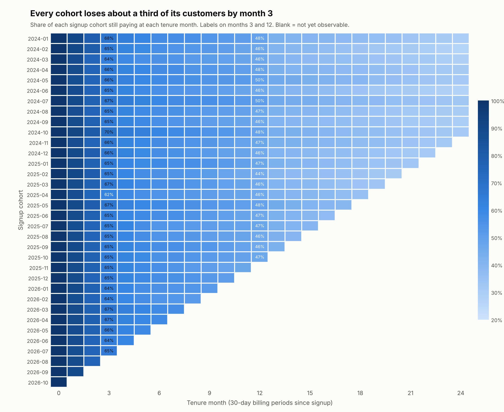
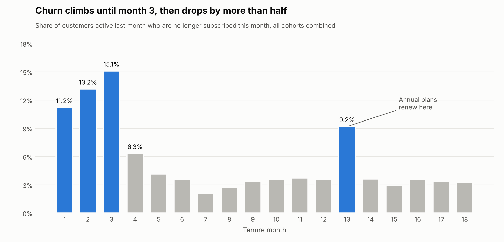
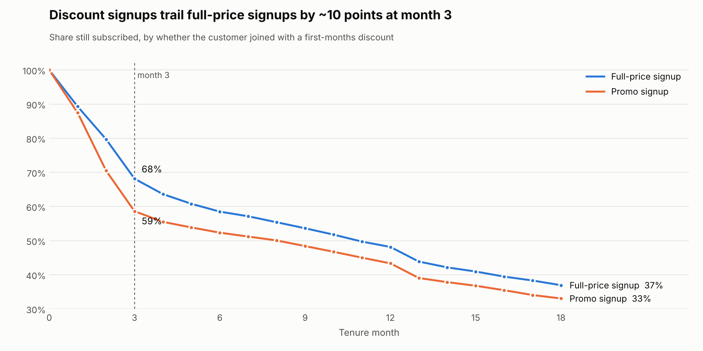

# Cohort Retention

**Question:** How long do StreamTH subscribers stay, and when in their lifecycle do we lose them?

All logic is in SQL (`sql/01`–`05`, DuckDB, run with `python src/run_sql.py`). Charts: `python src/plot_retention.py`.

## Definitions
| Term | Definition |
|---|---|
| Cohort | Calendar month of the first paid subscription |
| Tenure month *k* | Status checked on day `signup + 30k`, aligned to the 30-day billing cycle |
| Active | Has a paying subscription covering that day; win-backs count as active again |
| Logo retention | Active customers ÷ cohort size |
| GRR / NRR | Gross / net revenue retention on **list-price** MRR (annual ÷ 12). GRR caps each customer at their month-0 MRR, so upgrades cannot hide losses. Promo discounts are excluded so a discounted first month does not inflate later retention |
| Completeness rule | A (cohort, *k*) cell is shown only when every customer in the cohort has reached month *k* before the 2026-10-31 cut-off |

## Findings

### 1. A third of every cohort is gone by month 3 — and it is not getting better or worse

Month-3 retention sits between **62% and 70%** for all 31 cohorts observable that far, and month-12 retention between **44% and 50%**. The pattern is stable across two years of cohorts, so this is a structural onboarding problem, not a one-off campaign or seasonal effect.

### 2. Churn rises each month until month 3, then falls by more than half

| Tenure month | 1 | 2 | 3 | 4 | 6 | 12 | 13 |
|---|---|---|---|---|---|---|---|
| Churn of remaining customers | 11.2% | 13.2% | **15.1%** | 6.3% | 3.5% | 3.6% | **9.2%** |

- The first three billing cycles are the danger zone; after month 4 monthly churn settles around 3–4%.
- Month 13 is a **second cliff**: annual-plan customers face their first renewal (annual-plan retention falls from 100% at month 12 to 77% at month 13).
- Note: percentage points lost from the original cohort are almost flat across months 1–3 (~11–12 pp each) because the base shrinks; the *rate* among those remaining is what peaks at month 3. Reporting only cohort-level drops would hide this.

### 3. Discount signups leave faster

| | Month 2 | Month 3 | Month 12 |
|---|---|---|---|
| Full-price signup | 79.7% | 68.1% | 48.1% |
| Promo signup | 70.5% | 58.6% | 43.3% |

The gap opens at month 2 — the first full-price renewal after the 50%-off period — and never closes.

### 4. Channel and plan matter; device does not
| Month-3 retention | Lowest | Highest |
|---|---|---|
| Acquisition channel | social ads 61.6% | telco bundle 68.3% |
| First plan (monthly) | Basic with ads 57.9% | Premium 65.8% |
| Device | 65.2% – 65.7% (no meaningful difference) | |

### 5. Revenue retention tracks customer retention closely
GRR and NRR stay within about 1 point of logo retention (month 12: logo 46.7%, GRR 46.5%, NRR 47.6%). Losses are driven by customers leaving, not by downgrades; the small NRR premium comes from win-backs on a different plan.

## Behaviour before cancelling (feeds the early-warning work)
`sql/05_inactivity_streaks.sql` builds viewing gaps with gaps-and-islands. One early signal: **54%** of voluntary cancellations had **14+ days without viewing** at the end of the subscription, versus **12%** of other subscriptions. This is descriptive only; tenure and plan are controlled for in the survival and early-warning analysis.

## Implications
1. **Onboarding is the lever.** Effort spent in the first 90 days protects more customers than anything later.
2. **Treat month 2 as the promo cliff.** Promo customers need a reason to stay *before* the first full-price charge (e.g., a step-down price or a content hook), not a second discount after they cancel.
3. **Plan the annual renewal.** Remind annual customers ahead of month 12 with what they watched and a renewal incentive.
4. **Rebalance acquisition spend** toward channels whose customers stay (telco bundle, referral) once acquisition cost is factored in.
