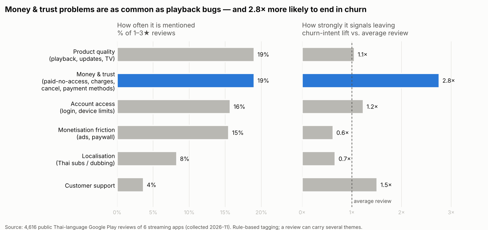

# Competitive Pain-Point Analysis

**Question:** What makes Thai users of existing streaming apps unhappy enough to leave — and how should StreamTH be designed to avoid it?

> This is the one part of the project built on **real, public data**: Thai-language Google Play reviews of six streaming apps. It informs StreamTH's (fictional) strategy; it does not describe StreamTH's own users. Raw review text is not published — only aggregated results and paraphrased examples.

## Data
| App | Reviews | Avg ★ | Review window |
|---|---|---|---|
| Netflix | 1,000 | 4.01 | Aug–Nov 2026 |
| Prime Video | 1,000 | 2.40 | Nov 2024–Nov 2026 |
| iQIYI | 1,000 | 3.88 | May–Nov 2026 |
| WeTV | 1,000 | 2.42 | Feb–Nov 2026 |
| Disney+ | 394 | 1.89 | May 2020–Nov 2026 |
| Viu | 222 | 3.51 | May 2016–Mar 2025 |
| **Total** | **4,616** | | 2,383 are 1–3★ ("negative") |

Collected with `src/collect_reviews.py` (newest Thai-language reviews, Thailand store). The App Store public review feed returned no entries, so iOS is not covered.

## Method
- **Multi-label, rule-based tagging** (`src/review_painpoints.py`): 14 pain points, each a lexicon of Thai + English patterns. Chosen over an ML classifier because it is transparent, auditable and needs no labelled training data.
- Lexicons were refined after reading random samples per tag (e.g. "paid but cannot watch" was split out of billing and playback; "cancel is hard" was split out of churn intent). Spot-check precision after refinement is roughly 85–90% for most tags and lower (~70%) for *content catalogue*.
- **Churn intent** = the review states the user has cancelled, will cancel, deleted the app, or is moving elsewhere. It is *stated* intent, not observed churn.
- **Lift** = churn-intent rate among negative reviews mentioning a theme ÷ churn-intent rate among all negative reviews (6.1%).

## Findings

### 1. Frequency is not severity
Ads are mentioned in 15% of negative reviews but carry **below-average** churn intent (0.6×): users complain and stay. **Money & trust** problems are just as frequent as product-quality problems (19% each) but **2.8×** more likely to end in a stated cancellation. Prioritising by mention count alone would point the roadmap at the wrong problem.

| Pain point | % of negative | Churn-intent lift |
|---|---|---|
| Cancellation is hard / charged after cancelling | 2.1% | **8.4×** |
| Charged unexpectedly / refund | 10.8% | **3.6×** |
| Payment method problems | 1.1% | 3.0× |
| App update / usability | 6.3% | 1.5× |
| Customer support unreachable | 3.7% | 1.5× |
| Login / account | 15.7% | 1.2× |
| Paid but no access | 10.1% | 1.2× |
| Playback stability | 12.0% | 1.1× |
| Thai subtitles / dubbing | 8.3% | 0.7× |
| Intrusive ads | 13.3% | 0.5× |

### 2. Each competitor has a signature weakness (share of its negative reviews)
- **WeTV** — ads, 35% (including ads on paid tiers and redirects to other apps)
- **iQIYI** — billing, 24%; hardest to cancel (7%)
- **Disney+** — login 28% and app-update backlash 26% (forced migration to a new app)
- **Prime Video** — paid-but-no-access 18%, playback 14%
- **Viu** — Thai subtitles 20% (small, older sample)
- **Netflix** — highest rated; complaints centre on login/household checks (18%) and Thai subtitles/dubbing (15%)

### 3. Thai-specific friction
Recurring themes that a global dataset would miss: no credit card → need PromptPay / mobile banking / TrueMoney; telco-bundle (AIS etc.) subscriptions not activating; Thai subtitle gaps on later seasons; dissatisfaction with AI Thai dubbing.

## Implications for StreamTH

| Theme | StreamTH response | KPI to track |
|---|---|---|
| Money & trust | Access granted instantly after payment with automatic self-check; renewal reminder 3 days before charge; **one-tap cancel**; automatic refund when access fails | % payments with access < 5 min; refunds per 1k subs |
| Payment methods | PromptPay QR, mobile banking, TrueMoney, smart retry on failure — also reduces *involuntary* churn | Payment success rate; involuntary churn share |
| Account access | Phone / LINE login, QR login on TV, reliable OTP | Login success rate |
| Product quality | Staged rollouts with rollback; TV app performance budget | Crash-free sessions; TV playback start time |
| Monetisation | No ads on paid plans; capped ad load on Basic; no redirect ads; no extra pay-per-episode inside paid plans | Ad complaints per 1k sessions |
| Localisation | Thai-subtitle SLA for new episodes; human dubbing for flagship titles; "Thai dub" filter | % titles with Thai subs at launch |
| Support | In-app chat with refund SLA | First-response time |

## How this feeds the rest of the project
- **Behavioural drivers & early warning:** support-ticket categories in the simulation map onto these themes; billing/access tickets are the strongest early-warning candidates.
- **Intervention plan:** the intervention plan should fix *money & trust* friction before spending on discounts — it targets the highest-lift reason for leaving at low cost.
- **Story point:** in StreamTH's exit survey only ~2% cite technical issues, yet behaviour shows ticket problems double churn risk; public reviews confirm that access and billing friction is a top driver. *What customers say in surveys is not the whole story.*

## Limitations
- Review windows differ greatly by app (3 months for Netflix vs. ~9 years for Viu), so cross-app comparisons are indicative only.
- Reviewers self-select and skew negative; shares describe complaints, not the user base.
- Thai-language Google Play only; no iOS.
- Keyword tagging misses sarcasm and very short reviews (33% of negative reviews carry no tag, mostly generic insults or one-word ratings).
- Churn intent is stated, not observed.
