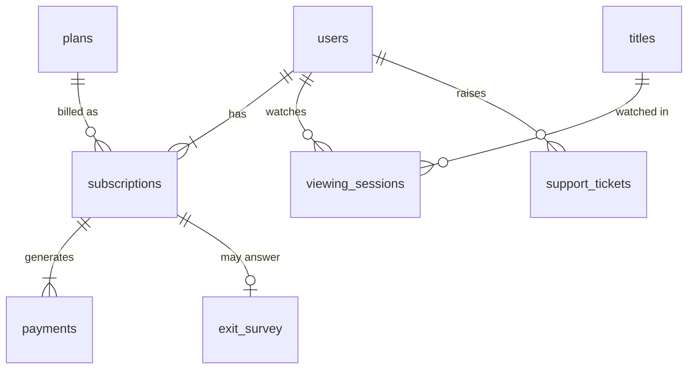

# Data Dictionary — StreamTH (synthetic)

Observation window: 2024-01-01 to 2026-10-31. Currency: THB. All files in `data/raw/`.

## users — one row per subscriber
| Column | Type | Notes |
|---|---|---|
| user_id | text PK | `U000001` |
| signup_date | date | = start of first paid subscription (defines cohort) |
| age_band | text | 18-24, 25-34, 35-44, 45-54, 55+ |
| region | text | Bangkok & Vicinity, Central, North, Northeast, South, East |
| device | text | Primary device: mobile, smart_tv, web, tablet |
| acquisition_channel | text | organic, social_ads, search, referral, telco_bundle |
| acquired_with_promo | bool | Signed up with discount (50% off first 2 months; 20% off first annual year) |

## plans
| plan_id | name | price_thb | billing_cycle | has_ads |
|---|---|---|---|---|
| P1 | Basic (with ads) | 99 | monthly | true |
| P2 | Standard | 219 | monthly | false |
| P3 | Premium | 349 | monthly | false |
| P4 | Standard Annual | 2,190 | annual | false |

## subscriptions — one row per continuous paid subscription
| Column | Type | Notes |
|---|---|---|
| sub_id | text PK | |
| user_id | text FK → users | A win-back creates a second row |
| plan_id | text FK → plans | |
| start_date | date | |
| end_date | date | NULL while active (right-censored at cut-off) |
| status | text | active, cancelled, payment_failed |
| cancel_type | text | voluntary, involuntary, NULL if active |

## payments — one row per charge attempt
| Column | Type | Notes |
|---|---|---|
| payment_id | text PK | |
| sub_id | text FK → subscriptions | |
| payment_date | date | Billing date; retries 1–3 days later |
| amount_thb | decimal | After promo discount |
| status | text | success, failed |

## viewing_sessions — one row per viewing session
| Column | Type | Notes |
|---|---|---|
| session_id | text PK | |
| user_id | text FK → users | |
| start_ts | timestamp | Minute precision |
| minutes | int | 1–400 |
| title_id | text FK → titles | Always released on/before session date |
| device | text | |

## titles — content catalogue
| Column | Type | Notes |
|---|---|---|
| title_id | text PK | |
| genre | text | drama, romance, comedy, action, thriller, horror, fantasy, documentary, anime, variety |
| origin | text | TH, KR, CN, US, JP |
| is_original | bool | StreamTH original |
| content_type | text | series, movie *(added beyond spec — needed for binge analysis)* |
| episodes | int | 1 for movies |
| release_date | date | |

## support_tickets
| Column | Type | Notes |
|---|---|---|
| ticket_id | text PK | |
| user_id | text FK → users | |
| created_at | timestamp | |
| category | text | billing, playback, login, content_request, subtitle |
| resolved_hours | decimal | **NULL = unresolved** |

## exit_survey — voluntary cancellations only (~65% response)
| Column | Type | Notes |
|---|---|---|
| user_id | text FK → users | |
| sub_id | text FK → subscriptions | *(added beyond spec — a user may cancel twice after win-back)* |
| cancel_date | date | Date the cancel request was made (≤ end_date) |
| reason | text | price, not_enough_content, not_using_enough, switching_service, joined_shared_account, finished_show, technical_issues, other |
| switched_to | text | Netflix, Prime Video, Disney+, iQIYI/WeTV, Viu, StreamTH shared account, None, Other |
