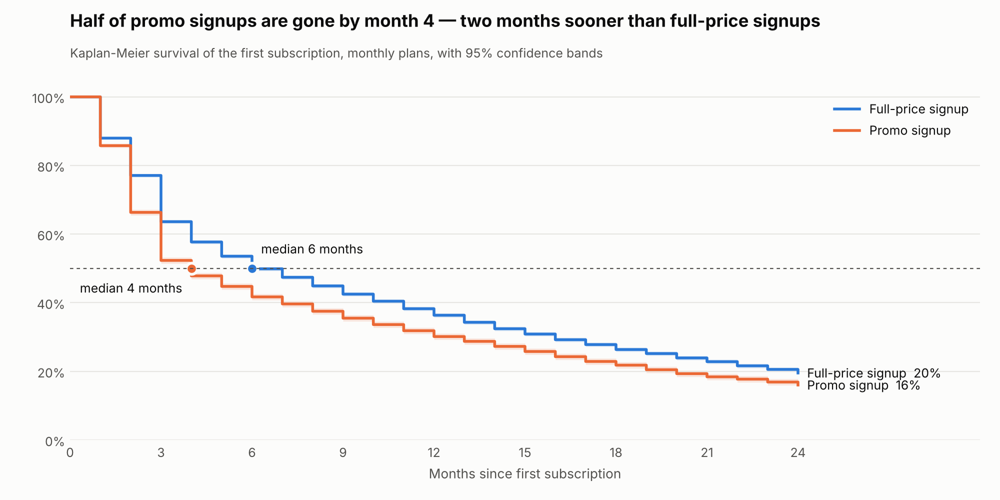
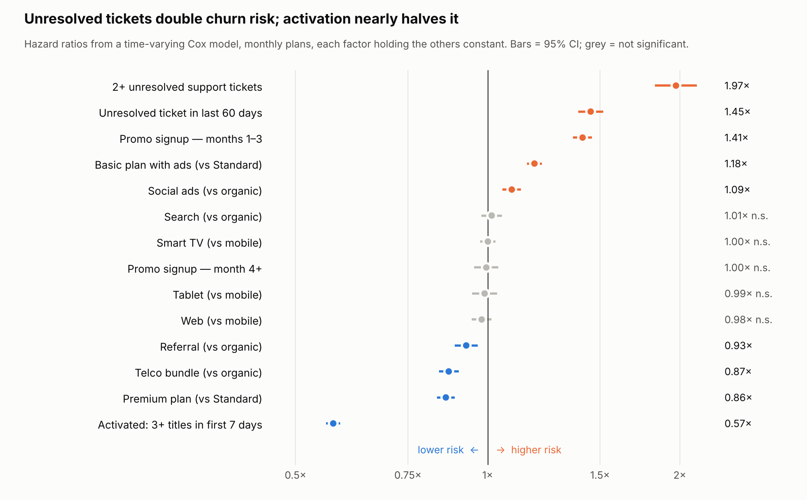

# Survival Analysis

**Question:** Are the differences seen in the cohort tables real, and which factors drive churn once everything else is held constant?

Run: `python src/survival.py` (after `src/run_sql.py`).

## Setup
- **Unit:** each customer's first subscription (49,956). Win-backs are left out so the clock measures one continuous stay; this is why survival here is a bit lower than cohort retention, which counts returning customers.
- **Censoring:** subscriptions still active on 2026-10-31 are censored, not counted as churn.
- **Event:** subscription ended (voluntary or payment failure).
- **Cox model:** monthly plans only. Annual plans can only end at day 365, which breaks the model's assumptions; they appear in the Kaplan-Meier results instead.

## 1. Kaplan-Meier: the gaps are real

| Segment | Median stay | Survival at month 3 | Month 12 |
|---|---|---|---|
| Full price (monthly plans) | 6 months | 63.6% | 36.4% |
| Promo (monthly plans) | **4 months** | 52.3% | 30.1% |
| Activated (3+ titles in first 7 days) | **13 months** | 75.3% | 52.6% |
| Not activated | 5 months | 58.5% | 35.3% |
| Basic plan with ads | 5 months | 57.3% | 30.4% |
| Premium plan | 8 months | 65.2% | 40.8% |

All segments, all plans: median 8 months; survival 64.9% at month 3 and 41.9% at month 12.

Log-rank tests reject "no difference" for every dimension tested (promo χ² = 189, activation χ² = 1,614, channel χ² = 117 on 4 df, plan χ² = 4,822; all p < 10⁻²⁰).

## 2. One hazard ratio is not enough for promo customers
A standard Cox model assumes each factor changes risk by the same multiple at every tenure. Testing that assumption (Schoenfeld residuals, rank time transform):

| Factor | Single hazard ratio | Assumption holds? |
|---|---|---|
| Promo signup | 1.29× | **No** (χ² = 95.4, p < 0.0001) |
| Basic plan | 1.22× | Yes (p = 0.23) |
| Activated | 0.58× | Mild violation (p = 0.0004) |

So the promo effect was split into months 1–3 and month 4+, and support tickets were added as **time-varying** factors measured at each renewal decision.

## 3. Time-varying Cox model: what drives churn

| Factor | Hazard ratio (95% CI) |
|---|---|
| 2+ unresolved support tickets | **1.97× (1.83–2.13)** |
| Unresolved ticket in last 60 days | 1.45× (1.39–1.52) |
| Promo signup, months 1–3 | **1.41× (1.36–1.46)** |
| Promo signup, month 4+ | 1.00× (0.95–1.04), not significant |
| Basic plan with ads vs Standard | 1.18× (1.15–1.22) |
| Social ads vs organic | 1.09× (1.06–1.13) |
| Referral vs organic | 0.93× (0.89–0.97) |
| Telco bundle vs organic | 0.87× (0.84–0.90) |
| Premium vs Standard | 0.86× (0.83–0.89) |
| Activated in first 7 days | **0.57× (0.56–0.59)** |
| Device (TV / web / tablet vs mobile), search channel | not significant |

### What this means
1. **The promo problem is a timing problem.** Promo customers are 41% more likely to leave during the first three months, but those who make it past month 3 are exactly as loyal as full-price customers. The fix is not "stop discounting" but "convert discount users before month 3".
2. **Support tickets matter, once tenure is controlled.** Pooled comparisons hid this (Simpson's paradox: long-tenure customers collect more tickets *and* churn less). Modelled properly, two unresolved tickets nearly double churn risk, and a recent unresolved ticket adds 45%.
3. **Activation is the strongest protective factor.** Watching three or more titles in the first week cuts churn risk by 43%, after adjusting for plan, channel, promo and tickets. It is also something the product can influence directly.
4. **Device does not matter**; channel and plan matter modestly.

## Caveats
- Observational data: hazard ratios are associations adjusted for the included factors, not proven causal effects. Activation, for example, may partly reflect pre-existing interest. An experiment (see intervention plan) is needed before attributing savings to it.
- Ticket factors use tickets created before each renewal decision, so there is no look-ahead.
- Data are synthetic; the analysis recovers the patterns described in [Simulation assumptions](simulation_assumptions.md), which is the point of testing the method.
